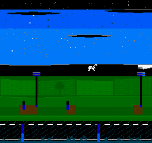
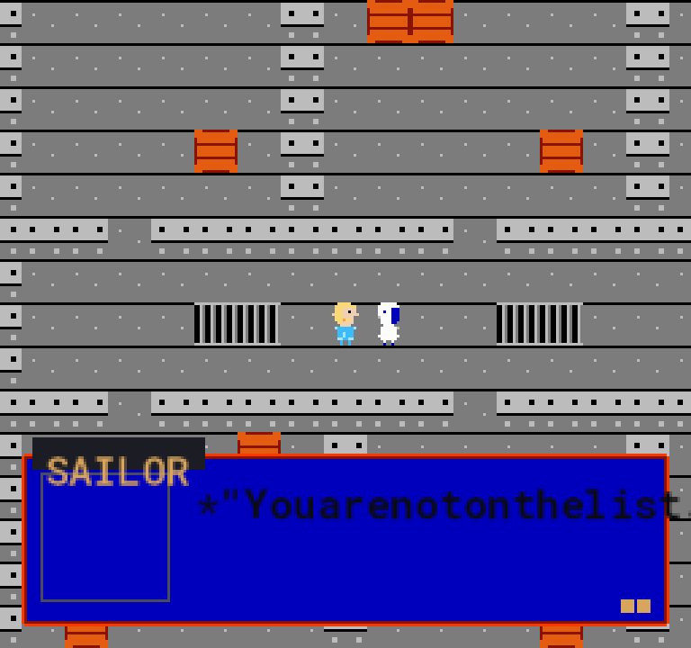
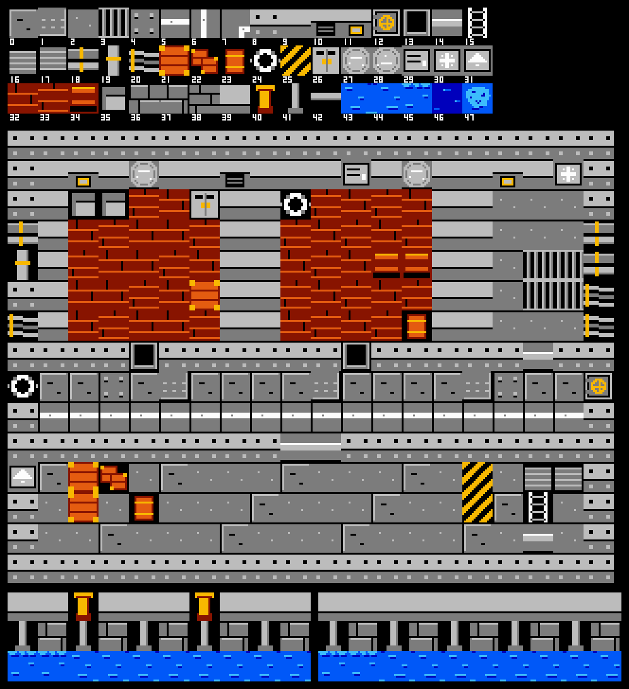
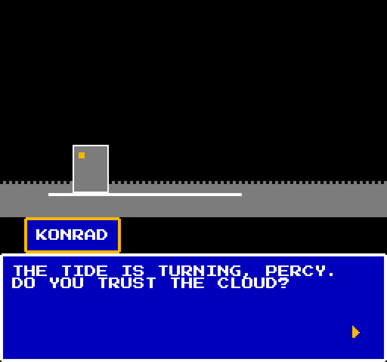
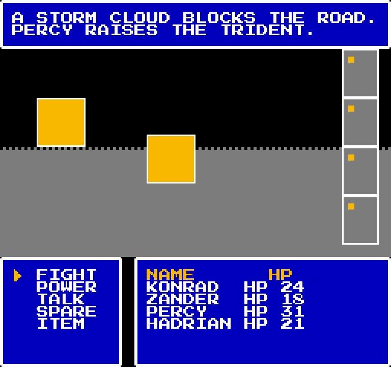
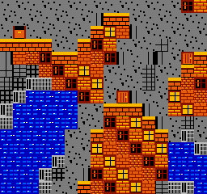

# Primordial Paradox: the engine (before the Meta hackathon kickoff)

This repository holds the **pre-existing engine** of Primordial Paradox. It is the core code that runs the game.

It holds the **real history of the engine**:

- 292 commits from 2026-10-19 to 2026-10-26 08:35 PT
- each with its original date, author and message

It ends before the Meta Global AI Developer Hackathon kickoff finished (2026-10-26, 12:24 PM ET = 09:24 AM PT). **Nothing in this repository was built during the event.**

The tag `engine-before-kickoff-2026-10-26` marks the last pre-event commit. The one commit after it only adds this README, its screenshots and a check on the README.

It stays separate, as the organisers asked. The hackathon repository holds only event work. It is the stored project folder for event work.

It uses this one as a dependency, outside code it loads.

The hackathon entry that builds on it: https://github.com/NayilRArana/primordial-paradox-hackathon

## How rudimentary it was

This page is deliberately plain. At the cutoff the engine was a skeleton with a strict art gate, a thin set of rooms, and music that
was drafted but unfinished. Everything a player would call "the game" (a story you can finish, fights, an ending, music that fits
each room) was built in the event repository afterwards. The evidence is below, with the file for each claim.

### What ran

A 256 x 240 NES style adventure built in GameMaker. From one build you could see the title screen, the opening crawl, the ship room,
an overworld walk and the dialogue box. Four rooms existed in `game/rooms`: `rm_pp_boot`, `rm_pp_title`, `rm_pp_ship` and
`rm_pp_drive`. No Meta model had answered a call from this code. The original front page of 2026-10-22 is kept as
`docs/README-as-written-2026-10-22.md`; it says "a vertical slice under construction, not a finished game".

### Screenshots from this tree

These are the images that exist in the snapshot, copied to `docs/screenshots/`. Most are committed preview frames, not captures of a
finished game; each caption says which.

| Image | What it shows | Origin |
| --- | --- | --- |
|  | The title backdrop at native 256 x 240: a starfield sky over a night road, drawn to the palette gate. | `output/nes_title_frame.png` |
|  | The ship deck with two sprites and the first dialogue box. The text is run together ("Youarenotonthelist") (the font and spacing were among the open items in the audit). | `output/ship_dialogue.png` |
|  | The ship tile sheet and the assembled ship rooms: grey plates, crates, grates, brick. A tile preview sheet, not a capture of play. | `output/env_ship_preview.png` |
|  | The dialogue window layout preview. | `output/ui_dialogue_preview.png` |
|  | The battle screen layout preview: command menu, party HP, and two flat yellow squares standing in for sprites. | `output/ui_battle_preview.png` |
|  | A map preview made from OpenStreetMap-derived data for Southampton, rendered as tiles. | `output/southampton_sample_frame.png` |

No capture of the crawl or of a fight survives in this tree, so none is shown.

### Gameplay loops and level design: almost none

* **The route was data.** `data/slice.json` names nine steps (title, crawl, drive, arrival, gate checkpoint, boarding, first fight,
  save, game over). The audit of 2026-10-22 found the steps were not yet one continuous run.
* **Levels.** `data/maps/all.json` holds 5 maps: the small ship deck, the cabin, the Southampton Town Quay (53 x 56 tiles), the dock
  office and the M3 drive corridor. They are tile grids with collision and triggers. There were no puzzles, no pacing and no
  designed encounter spaces beyond a 20 x 15 deck.
* **Combat.** `data/encounters/all.json` lists 3 encounters (`tutorial_sailors`, `deck_hound`, `percy`) and `data/scenes/all.json`
  lists 15 scripted scenes. The battle director, dodge arena and talk command existed as code, specs (`specs/07-battle-director.md`,
  `specs/08-dodge-arena.md`, `specs/16-talk-command.md`) and tests such as `tests/test_first_fight.py`. The audit saw no live fight.
* **What was built afterwards** (a finished story on the quay, two boss fights, kill and spare outcomes, credits, new music) is listed in the hackathon repository's README; none of it is in this tree as a playable result.
* **The self audit.** `knowledge/HACKATHON-AUDIT-2026-10-22.md` (kept in the hackathon repository) scores 22 subsystems from 0 to 4
  with evidence, mean **2.2**, nothing at 4, eight at 3. Battle, enemies, party, save, ledger, maps and UI scored 2 (code or data,
  unproven in the running game); the drive cutscene scored 1; docs scored 1. It was taken four days before the cutoff, so some rows
  had moved by 2026-10-26 (a drive room and a drive corridor map exist in this snapshot), but no row had reached 4.
* **Tests.** This tree has 94 test files with 1,480 `def test_` entries (counted with grep over `tests/`).

### Music at the cutoff: six draft cues, not one theme

It was more than a single title theme, and less than a score. `data/audio.json` lists 16 cue slots PP-01 to PP-16. **Six had a
rendered file** (PP-01 title waltz, PP-02 drive, PP-03 harbor, PP-04 navy sailors, PP-05 small ship, PP-06 Percy). **Ten were not
composed** (PP-07 to PP-16, among them the other bosses and both endings) and fell back to another cue. Every one of the 16 rows is
flagged `"placeholder": true`. There are 45 rendered `.ogg` files outside `assets/audio/sfx/`, which are many versions of those six
(for example title_theme v1 to v5, pp_03_harbor v1 to v4, pp_05_small_ship v1 to v5), plus 22 sound effects in `assets/audio/sfx/`.

How good were they, by the author's own ear critic? `assets/audio/EAR_SWEEP_2026-10-22.md` scored 9 masters on six 1 to 10 criteria
with a model listener. Hook reached 7, structure 7, tension 6, drums 5, and **human feel never passed 4**. The ledger says the
tracker renders were not yet musical in their phrasing: every master got the same advice (delayed vibrato on held notes, varied note
lengths, a real drum fill, a moving bass, a rest before the reprise). The first title theme, `assets/audio/title_theme/NOTES.md`,
was a mechanical rendering of a plan: A minor, 3/4, 84 bpm, 32 bars.

### What the NES graphics gate already enforced

This was the engine's real strength. `tools/nes_check.py` fails any PNG that breaks the Ricoh 2C02 rules: the 64 value PPU palette,
an 8 x 8 tile grid, at most 3 opaque colours per sprite tile, at most 3 colours plus backdrop per 16 x 16 background area, and at
most 25 colours on one screen. `tools/nes_audit_all.py` runs it over every asset and frame and writes `knowledge/NES-AUDIT.md`. At the
cutoff that audit read: **127 of 127 shipped assets pass**, 15 of 25 finished frames pass (10 fail), and the advisory sheets and window
captures mostly fail (they carry viewing scale, not art). The gate was strict enough to reject our own work, and that is why it was kept.

## Using it

You do not run this repository on its own.

Start with the hackathon repository's README. It gives the steps:

- clone this repo at the tag `engine-before-kickoff-2026-10-26`, a named saved version
- clone the hackathon repo
- run `python apply_event.py <path to this checkout>`

To build this snapshot by itself, a saved copy of the code, you need:

- GameMaker (LTS runtime 2026.0.0.23, proprietary, from YoYo Games), the program that builds the game
- Python 3.12 or newer with pytest, pillow, numpy, pyyaml, jsonschema and requests
- then run `python tools/gen_project.py` and `tools/run.ps1 -Compile`.

## Licence and dependencies

* See `LICENCE` in this repository for licence terms.
* See `CREDITS.md` in this repository for credits.
* See `knowledge/THIRD-PARTY-INVENTORY-2026-10-26.md` for third party pieces, meaning code from others, where present in this snapshot, meaning this saved copy.

<!-- readme-author: muse-spark-1.3 body-sha256: a5f733d69da210d26820056b3d813614c27d33a37ae8735385d59567f97167cb -->
